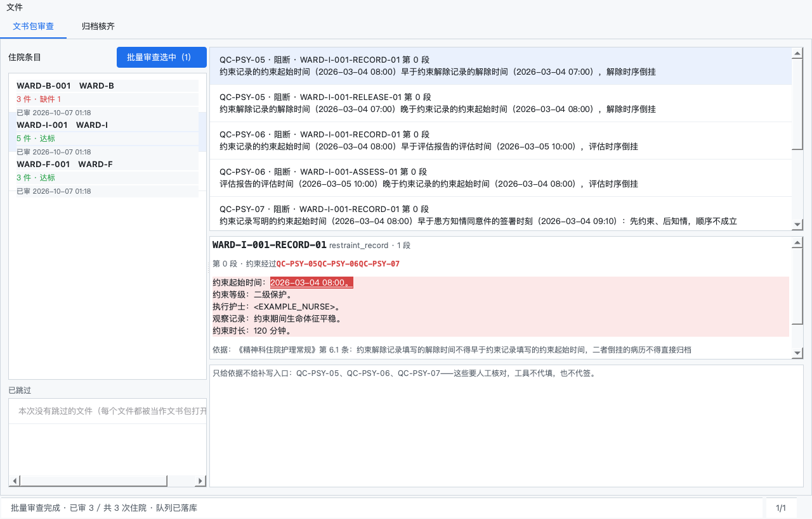
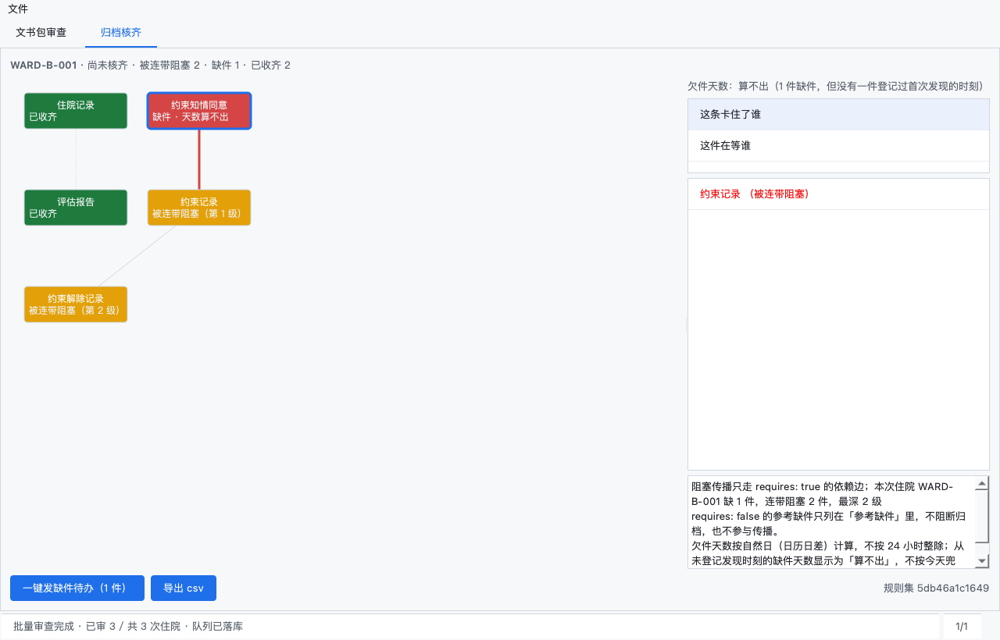
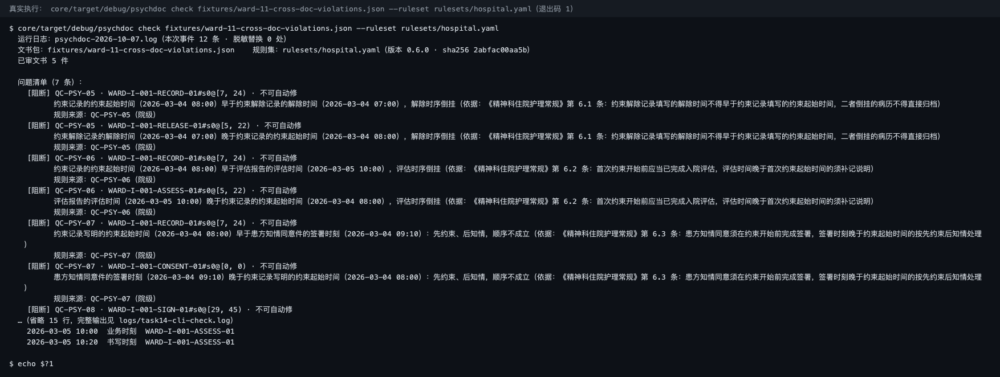

# 精神科住院文书审查系统

> 护士长把当天这一批住院文书包拖进窗口，十几秒后逐条亮出「哪份住院缺哪几件、哪一件的时间序不对、违反哪条码、依据是什么」；能补写的当场预览确认后回写建件并留痕，病案室按同一张清单勾收到「可归档」。

精神科病区的住院文书是**成套**的：约束知情同意、约束记录、约束解除记录、评估报告、签署页，缺一件、时序倒挂一件、签署缺一人份，这份病历就归档不了——而这套「受控文书包」的完整性往往靠人眼在十几个屏幕之间翻。本系统把这道核齐接缝做成**一台机器、两个视图**：常驻托盘监听病历变更、只重跑变过的件；护士长用「文书包审查」拿到带段落定位的清单，病案室用「归档核齐」看到正反向依赖图与欠件天数。系统只做**文书层面的缺项、时序与齐备性**提示与建件回写，不产出诊断或治疗建议，不做电子签名与代签。

## 适用场景 / 目标岗位

| 岗位 | 什么时候用 | 得到什么 |
|------|------------|----------|
| 精神科护士长 | 夜间事件（冲动 / 自伤 / 约束）后早交班前 | 一张按住院聚合的缺件与时序清单，逐条带规则码、段落定位与依据，能补写的当场预览确认 |
| 病区文书专员 | 出院前提交文书包 | 提交前预检：缺哪件、哪件时序不对，当场补齐再提交，不把缺件留到病案室 |
| 病案室质控员 | 每日接收出院病历核齐归档 | 归档核齐视图：谁缺谁、这条卡住谁、欠件几天，一键发缺件待办 |
| 质控办 | 月度专项抽查 / 事后复核 | 按当时的规则集版本回溯：某份病历当年按哪版规则审的、命中了哪几条 |

## 能力要点

- **一次拖入，整批出清单**：整文件夹按住院别名聚合成审查队列，十几秒后逐条给出「规则码 + 哪份文书第几件第几段 + 依据哪条规范」，不用再逐份翻文书。
- **可定位到段落，而不是只报「有问题」**：每条问题带文书别名、件序号、段落序号与段内区间，违规段落整段高亮；跨文书时序问题自动把两件的定位并排给出。
- **不可自动修的，只给依据不给按钮**：需要医务人员本人判断的条目只显示违反依据，不提供「一键修复」，避免把文书责任推给工具。
- **写回前必须人工逐条勾选**：补写内容先落本地草稿，双栏对照原文，确认后一次性发一笔建件请求并生成留痕；未勾选任何条直接拒绝发送。
- **同一件当天不会建两次，事后可按当时版本复核**：写回带幂等键，重复确认只提示「已由某人在某时刻提交」不产生第二条记录；每次审查把规则集版本号与命中码一起落盘，质控办能还原「这份病历当年按哪版规则审的」。

## 快速开始

### 依赖

| 依赖 | 版本 | 说明 |
|------|------|------|
| Python | ≥ 3.10 | 桌面壳运行时 |
| Rust | ≥ 1.75 | 核心 crate 编译工具链 |
| PySide6 / pyo3 | ≥ 6.6 / ≥ 0.22 | GUI 控件与 QSS 样式 / Rust 核心与桌面的绑定 |
| maturin（可选） | ≥ 1.4 | 打包绑定；没装时 `run.sh` 回落到 `cargo build` |
| 网络（仅写回与通知时） | 可访问院内 FHIR R4 端点 | 本地审查不需要，缺凭据不拦启动 |

### 安装

```bash
git clone <repo-url> psych-inpatient-doc-audit && cd psych-inpatient-doc-audit
python3 -m venv .venv && source .venv/bin/activate && pip install -e .

# 构建 Rust 核心（cdylib + CLI 二进制）：装了 maturin 走 maturin，只装了 cargo 走 cargo build
maturin develop --manifest-path core/crates/psychdoc-ffi/Cargo.toml
# 或（无 maturin 时）：( cd core && cargo build -p psychdoc-ffi --features extension-module )
```

> `run.sh` 会自动检测：绑定不存在时先试 `maturin develop`，没有就用 `cargo build` 并把产物装到 `bindings/`。

### 配置

复制 `.env.example` 为 `.env` 并填入院内真实值。写回与缺件通知所需的五项（`EMR_*` 与 `WECOM_*`）**缺失时启动自检会
一次列全并提示**，本地文书包审查仍可照常跑，只有真正要连端点的链路才会拿到 `E_CFG_MISSING`；**规则集缺失或非法则
直接拒绝启动**（退出码 2）——没有规则时给出「全部通过」比不给结论更危险。两种情况都**不**静默降级为本地替身。
`psychdoc preflight` 一次看全缺项、全程零次网络请求（真实回显见 [`docs/examples.md`](docs/examples.md) 第 5 节）。

| 配置项 | 默认值 | 说明 |
|--------|--------|------|
| `EMR_BASE_URL` | 无（必填） | 院内 FHIR R4 服务根地址 |
| `EMR_CLIENT_ID` | 无（必填） | OAuth2 客户端标识 |
| `EMR_CLIENT_SECRET` | 无（必填） | OAuth2 客户端密钥 |
| `EMR_TENANT_ID` | 无（必填） | 院内租户标识，随 `X-Tenant-Id` 请求头下发 |
| `WECOM_WEBHOOK_URL` | 无（必填） | 企业微信群机器人地址，用于缺件通知 |
| `PSYCHDOC_RULESET` / `PSYCHDOC_CACHE` | `rulesets/hospital.yaml` / 无（默认不启用增量） | 规则集路径（相对路径按启动时工作目录解析）；增量缓存文件路径，配了才按件内容哈希跳过未变过的件 |
| `PSYCHDOC_DATA_DIR` / `PSYCHDOC_LOG_LEVEL` | 平台用户数据目录 / `info` | sqlite 落盘位置（不会落在项目目录里）；结构化日志级别，不认识的级别报 `E_CFG_INVALID` 不回落成默认 |

### 构建与验证

```bash
( cd core && cargo test )             # 核心 crate 单测（解析 / 规则 / 依赖图 / 存储 / 对接层 / CLI 契约）
python -m pytest tests -q             # 桌面壳与集成测试
./run.sh                              # 启动桌面窗口 + 托盘常驻
```

### 主命令速查

```bash
./run.sh                                       # 启动桌面窗口 + 托盘常驻
psychdoc preflight                             # 启动自检：一次列全缺项，0 次网络请求
psychdoc check fixtures/ --ruleset rulesets/hospital.yaml              # 无 GUI 跑一次审查
psychdoc check fixtures/ --ruleset rulesets/hospital.yaml --cache /tmp/pc.json   # 增量：只重跑变过的件
psychdoc graph WARD-B-001 --input fixtures/ --ruleset rulesets/hospital.yaml --direction both
psychdoc writeback-dryrun selection.json       # 只构造建件请求摘要，不外发
psychdoc rule-regress / export-audit / codes   # 规则回归 / 导出审计包 / 查错误码
```

## 命令 / API / 配置说明

### 关键配置项

见上文「配置」表。凭据一律从环境变量读取，代码中不硬编码，也不写进 sqlite、运行日志或导出包；七个 CLI 子命令里**只有 `check --live` 需要凭据**，其余六个纯本地，可在没连院内端点的机器上跑全。

### CLI 子命令 / 接口端点

无 GUI 回归与运维通道（退出码契约 0/1/2/3）：
| 命令或路径 | 用途 | 关键参数 |
|------------|------|----------|
| `psychdoc check` | 对单个 Bundle 或整个目录跑一次审查，输出问题清单 | `<bundle\|dir>`、`--ruleset`、`--cache`、`--record`、`--actor`、`--live` |
| `psychdoc graph` | 输出归档核齐视图数据（正反向） | `<住院别名>`、`--input`、`--ruleset`、`--direction`、`--as-of` |
| `psychdoc writeback-dryrun` | 只构造建件请求并打印摘要，**不发任何网络请求** | `<selection.json>`、`--out <Bundle.json>` |
| `psychdoc rule-regress` | 批量跑规则回归用例并输出按码覆盖率 | `--cases`、`--ruleset`、`--root`、`--only`、`--json` |
| `psychdoc export-audit` | 导出审计包（规则集版本 + 命中码 + 推进人 + 时刻） | `--db`、`--alias`、`--run`、`--since`、`--until`、`--at`、`--format`、`--out` |
| `psychdoc codes` / `psychdoc preflight` | 导出完整错误码表或查单条码处置建议；启动自检一次列全缺项（零次网络请求） | `--format markdown\|json\|text`、`--code` |
| `GET {EMR_BASE_URL}/fhir/r4/Composition` | 读文书件，支持 `_since` 增量与 Bundle 分页 | `Authorization`、`X-Tenant-Id`、`Accept` |
| `POST {EMR_BASE_URL}/fhir/r4` | 发 Bundle transaction 建件并生成 Provenance；`POST {WECOM_WEBHOOK_URL}` 发缺件通知 | `Authorization`、`X-Tenant-Id`、`msgtype=markdown` |

全局选项：`--json` 让 stdout 只输出一段机器可读 JSON（人类可读过程文字改进日志），`--log-file <路径>` 把完整过程写进磁盘日志。全参数与字段规范见 [`docs/cli.md`](docs/cli.md)。

### 错误与降级

| 场景 | 表现 | 处理方式 |
|------|------|----------|
| 凭据缺失 / 为空 | 启动即报 `E_CFG_MISSING`，列出全部缺失项，退出码 2 | 补齐环境变量后重启；**不**降级为离线模式 |
| 规则集引用未定义文书类型 / 码重复 | `E_RULESET_INVALID`，该批**拒绝启动** | 修规则集后重跑；不按「无规则=通过」处理 |
| 件按名称配对出现歧义 | 该件标 `ambiguous` 并入人工队列 | 人工在 EMR 侧消歧后重载；不静默配对 |
| 时间戳缺失或精度不足 | 该条时间序规则跳过并记 `skipped_reason` | 补齐件内业务时刻；不用当前时间兜底 |
| 文书依赖规范成环 | `E_DEP_CYCLE`，环内节点标 `ambiguous`，不产生任何边 | 修院内依赖规范；环外节点照常出图 |
| 建件请求中途失败 / 端点限流 | 整批回滚 **0 条部分写入**、本地草稿保留；读按 `Retry-After` 退避 | 修端点后从草稿重发，不重复已生效部分 |
| 同一件当天重复确认 | 幂等键命中，返回首次提交的操作人与时刻，**0 条新写回** | 无需处理；确需重提请先改内容产生新键 |
| 某条规则码缺正例 / 反例 / 边界例 | 覆盖矩阵标「缺位」，覆盖率掉到 100% 以下，退出码 1 | 补齐三类用例；删用例不算回归通过 |
| 端点限流 / 瞬时故障 | 读按 `Retry-After` 或指数退避重试，写最多 3 次后报明确错误码 | 稍后重试；已入重试队列的通知会续发 |

**完整错误码表**（每一条的触发条件、是否可重试、处置建议）直接问命令，不用翻源码。这张表由代码生成：
代码里加了新码而表里没登记，`cargo test -p psychdoc-store --test observability` 会当场失败并指出缺哪个码。
每次审查还会在用户数据目录的 `logs/` 下留一份结构化运行日志（按日切分，一行一条事件，`jq` 直接读）。
全表另见 [`docs/error-codes.md`](docs/error-codes.md)。

```bash
psychdoc codes --code E_SCHEMA_TOO_NEW     # 查不到会明说查不到，不拿近似的那一条糊过去
psychdoc codes --format markdown           # 整表导出，可直接贴进工单或交办单
```

### 对接现有系统

- **读**：`Composition` / `DocumentReference`，FHIR R4 REST，支持 `_since` 增量拉取与 Bundle 分页遍历。**写**：`Bundle` transaction 建件 + `Provenance` 留痕，一次事务整批提交；另发 `msgtype=markdown` 到企业微信群机器人。
- **凭据来源**：五项凭据全部从环境变量读，代码中不硬编码。`fixtures/` 下的合成脱敏 Bundle 只属于测试数据层，**替身不是最终对接面**。

## 典型场景

### 场景 1：护士长夜间事件后早交班前

从托盘图标进入「文书包审查」，把当班导出的整个文件夹拖进窗口；窗口按住院别名聚合成队列，左栏列缺件数徽标。
选中一份住院，右栏逐条亮出缺哪件、哪件时序倒挂、违反哪条码、依据哪条规范；对可补写的条目点「预览补写」，
看双栏对照后逐条勾选，确认回写建件。

```bash
psychdoc check fixtures/ --ruleset rulesets/hospital.yaml   # 等价的无 GUI 通道
```

### 场景 2：病案室每日归档核齐

切到「归档核齐」标签选中当日待归档的住院，依赖图显示缺件（红）、被连带阻塞的件（橙）、正常件（绿），阻塞边加粗；
右侧看欠件天数并切「这条卡住了谁」「这件在等谁」；点「一键发缺件待办」推送到科室群，已发项按钮置灰并显示发送时刻与操作人。

```bash
psychdoc graph WARD-B-001 --input fixtures/ --ruleset rulesets/hospital.yaml --direction dependencies
psychdoc graph WARD-B-001 --input fixtures/ --ruleset rulesets/hospital.yaml --direction dependents   # 两份清单必须不同
```

### 场景 3：质控办月度专项抽查与事后复核

导出抽查范围的审计包（规则集版本 + 命中码 + 推进人 + 时刻 + 幂等键）；对争议病历按住院别名与时间点回溯当时生效的
规则集版本，核对该版本下的命中码集合与豁免记录，确认抽查结论与当时一致。

```bash
psychdoc export-audit --format csv --out audit.csv    # 导出前先打一份批次摘要核对范围
psychdoc export-audit --alias WARD-I-001 --at 2026-03-05T10:00:00+08:00 --format json   # 按时间点回溯当时版本
```

## 输出样例

以下都是**真实运行回显**，数据来自 `fixtures/` 下的脱敏合成文书包（无患者姓名、无住院号）；每类产物的完整回显见 [`docs/examples.md`](docs/examples.md)。

### 问题清单（`psychdoc check`，退出码 1）

```text
文书包：../fixtures/ward-11-cross-doc-violations.json    规则集：../rulesets/hospital.yaml（版本 0.6.0 · sha256 2abfac00aa5b）
已审文书 5 件 · 问题清单（7 条）：
  [阻断] QC-PSY-05 · WARD-I-001-RECORD-01#s0@[7, 24) · 不可自动修
        约束记录的约束起始时间（2026-03-04 08:00）早于约束解除记录的解除时间（2026-03-04 07:00），
        解除时序倒挂（依据：《精神科住院护理常规》第 6.1 条：约束解除记录填写的解除时间不得早于
        约束记录填写的约束起始时间，二者倒挂的病历不得直接归档）
        规则来源：QC-PSY-05（院级）
  …（违反的两件各给一条定位，是时间序规则的固定形态；另有 QC-PSY-06/07 各两条、QC-PSY-08 一条）
事件时间线（WARD-I-001，13 条事件）：
  2026-03-04 07:00  业务时刻  WARD-I-001-RELEASE-01   2026-03-04 08:00  业务时刻  …-RECORD-01
```

`#s0@[7, 24)` 是「第 0 段 · 字符 7 到 24」，该区间切回原文正好是被判的那个时刻字面量。合规反例包
`ward-12-cross-doc-compliant.json` 输出「未发现规则命中项」，退出码 0；缺时刻时走的是「判不了」而不是
「通过」——清单为空但并列列出 `[未判定] QC-PSY-05 · WARD-D-001 · 对照件不在本次文书包内：…`，
该件在时间线里标 `（无时刻）  整件抽不出任何时刻，时间序相关检查已跳过`。

### 归档核齐依赖图（`psychdoc graph`，退出码 0）

```text
归档核齐视图：WARD-B-001（核算时刻 2026-10-07T01:21:36+08:00）
结论：已核齐（零缺件 · 零连带阻塞 · 零人工待办）
件清单（5 件）：
  [在库] WARD-B-001-CONSENT-01 · 约束知情同意   在等（正向）：无
      卡住（反向）：WARD-B-001-RECORD-01（约束记录）
  [在库] WARD-B-001-RECORD-01 · 约束记录       在等（正向）：WARD-B-001-CONSENT-01（约束知情同意）
      卡住（反向）：WARD-B-001-RELEASE-01（约束解除记录）
  …
口径说明：
  · 阻塞传播只走 requires: true 的依赖边；缺 0 件，连带阻塞 0 件，最深 0 级
  · 欠件天数按自然日（日历日差）计算，不按 24 小时整除；从未登记发现时刻的缺件天数
    显示为「算不出」，不按今天兜底。
```

查一个根本没有的住院别名会退 2 并报 `E_ENCOUNTER_UNKNOWN`（空视图会被误读成「已核齐」），
而不是返回空视图。

### 建件请求摘要与审计导出包

```text
写回干跑：WARD-A-001 · 1 条 · 时刻 2026-03-05T08:20:00+08:00
Bundle 类型：transaction（transaction = 要么整批生效，要么零条生效）
Bundle 条目 2 条（其中末条为 Provenance）：POST Composition · POST Provenance
幂等键（同一份内容今天重复提交会被这几条挡下）：
  WARD-A-001-CONSENT-01 · 84b50317895c76e14940b429705308da774db432379d3055093e7a474af33626
本次未发起任何网络请求（干跑：不取 token、不连端点、不落库）。

psychdoc: E_FHIR_TXN_EMPTY：勾选清单是空的，拒绝构造 transaction（与真发同码 E_FHIR_TXN_EMPTY）
```

`writeback-dryrun` **0 次网络请求**，勾选为空时与真发**同码**。`export-audit --format csv` 带 UTF-8 BOM
（Excel 直接打开不乱码），导出期另做一次**二次脱敏扫描**，导出前先打一份批次摘要核对范围（批次号 / 住院别名 /
规则集版本 + sha256 / 操作人 / 时刻 / 审了几件 / 命中码集合 / 导出几行）；表头 18 列中 `豁免原因` 与 `折叠去向`
让「这条为什么没报 / 为什么被合并」在导出包里说得清。

## 概念 / 实测对照

### 视觉目标

见 [`docs/concepts/visual-target.md`](docs/concepts/visual-target.md)：以**结构化视觉目标卡**给出起始态、首个可用瞬间、
成形态三态（配色 `#1F6FEB` 可操作 / `#D64545` 缺件 / `#2DA44E` 达标 / 底 `#F6F8FA`、字体与信息层级、留白密度、
必须可达的约束）。本环境无图像生成能力，故**不放置任何图片文件**，不伪造概念图。

### 实测证据

以下四张是**运行期真跑出来的**窗口与终端抓图，由 `scripts/capture_screenshots.py` 用 `QScreen.grabWindow()`
抓窗口自身绘制结果生成（不是设计稿，也不是事后拼的效果图）；逐图生成命令与夹具来源见该目录 README。






> **诚实标注**：上为视觉目标（设计意图，`docs/concepts/`），下为真实实测（运行期抓图，`docs/screenshots/`）。差距写在
> 明处，不声称完全一致：目标卡设想**自由布局的层级依赖图**，实测为在 1280×820 一屏读清改成**左图右清单固定栅格**，
> 层级靠红/橙/绿三色 + 第 N 级标注表达，没有自由拖拽；目标卡写「徽标形如 `缺 3`」，实测按实际缺件数渲染、
> 欠件天数算不出时显示「算不出」而非「0 天」——这是刻意偏离目标卡的设计决定；实测图是 Qt 原生控件渲染，无额外包装。

## 架构与数据流

```
  脱敏文书包 / 院内 FHIR R4 端点
            │
            ▼
  ┌──────────────────────────────────────────────────────────┐
  │ 发现与实体绑定 → 三层解析（部分成功）→ 规则集加载           │  按类型字典过滤；件按 Composition.id
  │ 院→科室→个人三级 + 病区豁免谓词 + sha256 版本冻结          │  绑定（禁止按文件名配对）；产出件→字段表
  └───────────────────────────┬──────────────────────────────┘  →时间戳集合；加载期强校验不降级
                              ▼
  ┌───────────────────────────────┬──────────────────────────┐
  │ 规则执行器 A/B/C：QC-PSY-01~08  │ 文书依赖图                │  执行器：件-字段类 / 跨文书时间序 / 签署齐备性
  │ 码 + 段落定位 + 依据 + 可否自动修│ Collector→Resolver→     │       去重择优与严重度分层
  │                                  │ Tarjan SCC → 正反向       │  图：环检测 → 阻塞闭包 → 欠件天数
  └───────────────┬───────────────┴──────────┬───────────────┘
                  ▼                          ▼
  ┌──────────────────────────────────────────────────────────┐
  │ 本机 sqlite：件级状态机 + 幂等键 + 审计链                    │  缺失→草稿→已建件→已收→可归档；
  │ 写回草稿 → 人工逐条勾选 → 整批 Bundle transaction          │  调阅与写回各留一条 Provenance
  └───────────────────────────┬──────────────────────────────┘
                              ▼
   桌面窗口双视图（文书包审查 / 归档核齐）· 托盘角标 · 企业微信缺件待办 · 审计导出包
```

### 关键不变量

- **幂等键**：`sha256(住院别名 + 件 id + 内容哈希)`，写回表建唯一约束；同键重复提交返回首次的操作人与时刻，**0 条新写回**。
- **状态不可跳步**：件级状态机 `缺失 → 草稿 → 已建件 → 已收 → 可归档`，非法跳变（如 `缺失 → 可归档`）被拒并记 `E_STATE_JUMP`，不静默接受。
- **实体绑定不靠文件名**：件按 `Composition.id` / 模板标识绑定；跨系统同名文书输出 `ambiguous` 交人工，不静默配对。
- **失败不静默改数据**：建件事务中途失败整批回滚（0 条部分写入），本地草稿保留可重试；解析失败件进 `unresolved` 清单附原因码，**禁止**整批失败也**禁止**静默丢弃。
- **版本可回溯且不越界**：每次审查把规则集 sha256 与命中码集合一起落盘，事后按住院别名 + 时间点可还原当时生效的版本；只做文书层面的缺项、时序、齐备性提示与建件，不产出诊断或治疗建议，不做电子签名或代签。

前四条各由一组测试强制守住（非法跳变不改变既有状态、同键提交零新行、跨系统同名文书零连边、环外节点不因局部错误连坐全盘）。逐条口径见 [`docs/architecture.md`](docs/architecture.md)。

## 安全与合规边界

- **不做临床决策**：不产出诊断、治疗方案或用药建议；所有输出是文书层面的缺项、时序与齐备性提示。
- **不做电子签名 / 代签**：签署类问题只提示「签署齐备性缺项」与依据，签名动作仍在 EMR 侧由医务人员本人完成。
- **不落患者可识别明细**：只处理 `Composition.id` 及其脱敏别名，不接收、不存储姓名 / 住院号 / 身份证明文；写盘前对日志做二次脱敏扫描。
- **写回须人工确认，凭据不落盘**：补写内容先落本地草稿，人工逐条勾选后才整批提交，未勾选直接拒绝发送，撤回即回草稿区不产生已生效事实；五项凭据全部从环境变量读取，不硬编码、不写入 sqlite、不出现在日志与导出包中。

## 验收与自检

| 验收项 | 命令 | 期望结果 |
|--------|------|----------|
| 核心 crate 单测全绿 | `cd core && cargo test` | 解析 / 规则 / 依赖图 / 存储 / 对接层 / CLI 契约各 crate 测试全部通过 |
| 桌面壳与集成测试通过 | `python -m pytest tests -q` | FFI 绑定、队列、卡片渲染、归档视图、托盘、主窗口测试通过 |
| 启动自检列全缺失项 | `psychdoc preflight` | 一次列全 5 项缺失并声明「不会静默降级」；**0 次网络请求**；退出码 2 |
| 一条命令出可核对清单 | `psychdoc check fixtures/ --ruleset rulesets/hospital.yaml` | 打印带规则码、`件别名#s段@区间`、规范依据与规则来源层的清单；blocking 存在时退出码 1 |
| 合规反例零命中 | `psychdoc check fixtures/ward-12-cross-doc-compliant.json --ruleset rulesets/hospital.yaml` | 输出「未发现规则命中项」，退出码 0（误报守卫） |
| 增量只重跑变过的件 | 同上加 `--cache /tmp/pc.json`，改一件后再跑一次 | 首跑「重跑 N 件 / 跳过 0 件」；次跑「重跑 1 件 / 跳过 N-1 件」；两次诊断逐条相等 |
| 正反向依赖图答案不同 | `psychdoc graph WARD-B-001 --input fixtures/ --ruleset rulesets/hospital.yaml --direction both` | 正反两向各自可复现且并集等于可达集；查不存在的别名退 2 而非返回空视图 |
| 规则回归全绿、覆盖不缺位 | `psychdoc rule-regress` | 24 条用例（8 码 × 正例/反例/边界例）全部通过，覆盖率 100%，退出码 0 |
| 干跑不外发 / 空勾选被拒 | `psychdoc writeback-dryrun <selection.json>` | 只打印建件请求摘要 + 幂等键，**0 次网络请求**；`entries: []` 报 `E_FHIR_TXN_EMPTY` 退 2，与真发同码 |
| 错误码可自查 | `psychdoc codes --code E_DEP_CYCLE` | 打印该码的触发条件、是否可重试、处置建议；查不到就明说查不到 |
| 规模基准与截图可复现 | `./scripts/bench_batch_scan.sh` · `python3 scripts/capture_screenshots.py` | ≥200 件批扫在预算内完成、零静默跳过可核对（结果落 `docs/bench/`）；重新生成 4 张真实截图 |

## 项目结构

```
psych-inpatient-doc-audit/
├── README.md / LICENSE / qrcode.jpg   # 本文件 / MIT / 关注区块配图
├── pyproject.toml / .env.example      # PySide6 + maturin 构建配置 / 五项凭据与四项配置样例
├── run.sh / run.bat                   # 现场一键启动（Python / 绑定 / 凭据自检）；.gitignore 排除 target 等构建产物
├── core/crates/
│   ├── psychdoc-model/                # 件/字段/段落/位置区间/诊断三件套/件级状态机
│   ├── psychdoc-parse/                # 发现·过滤·实体绑定·三层解析 + 增量缓存
│   ├── psychdoc-rules/                # 三级覆盖·sha256 冻结 + 三类执行器 + 豁免谓词 + 回归引擎
│   ├── psychdoc-graph/                # Collector→Resolver→正反向图 + 环检测 + 阻塞闭包 + 欠件天数
│   ├── psychdoc-fhir/                 # FHIR R4：读 + Bundle transaction 写 + Provenance + 通知
│   ├── psychdoc-store/                # sqlite 持久化 + 幂等键 + 审计链 + 版本化迁移
│   ├── psychdoc-ffi/                  # PyO3 绑定层：8 个同步入口（api 业务 + 搬运 + jsonval 转换）
│   └── psychdoc/                      # CLI 二进制：七个子命令 + 0/1/2/3 退出码契约
├── desktop/                           # PySide6 桌面壳
│   ├── main_window.py / archive_view.py / doc_card.py   # 双标签主窗口 / 归档核齐视图 / 文书卡片（高亮+依据行+双栏 diff）
│   ├── tray.py / workers.py / theme.py                # 托盘常驻 / QtConcurrent / QSS
│   └── core_bridge.py / main.py                        # 绑定定位·队列聚合·错误码归一 / 启动自检
├── conftest.py / bindings/            # pytest 环境（offscreen）/ 本机构建产物
├── rulesets/ fixtures/                # 规则集与 24 条回归用例 / 脱敏合成文书包
├── templates/                         # 段落骨架说明（骨架本身随规则集走，见该目录 README）
├── scripts/ tests/                    # 截图采集·夹具生成·批扫与规模基准脚本 / 桌面壳与集成测试
└── docs/                              # cli.md（CLI 全参数）· architecture.md（状态机·幂等键·依赖图·审计链）
                                        # examples.md（完整输出回显）· error-codes.md（全量错误码表）
                                        # rule-regress-coverage.md · fixture-catalog.md · e2e-reproduction.md · bench/ · concepts/ · screenshots/
```

## License

MIT

---

## 关注我们

欢迎扫码关注公众号，获取项目更新与交流加群：

